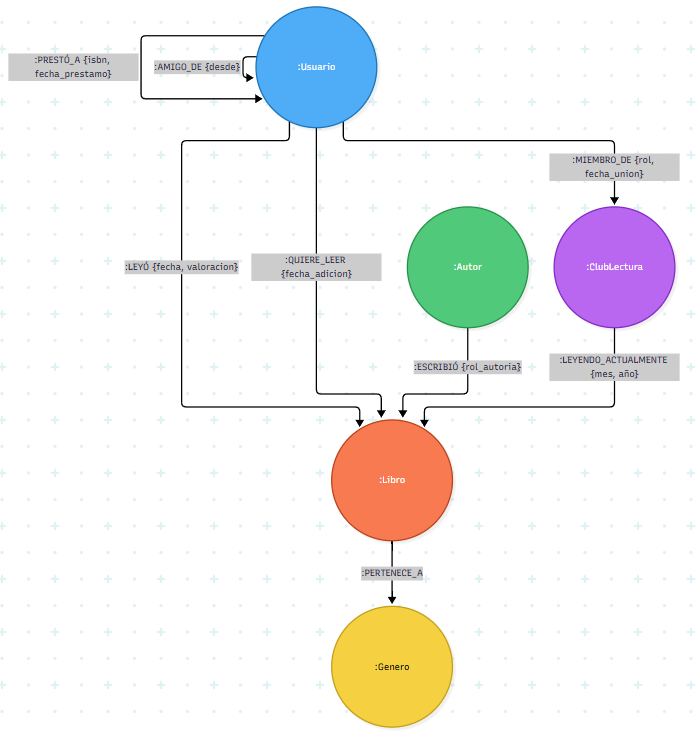

## Actividad 2. Diseñar grafo de nodos y relaciones

### 1. Etiquetas de Nodos (Labels) y Propiedades

| Etiqueta       | Propiedades Obligatorias                                       | Propiedades Opcionales                                               |
| :------------- | :------------------------------------------------------------- | :------------------------------------------------------------------- |
| `:Usuario`     | `id_usuario` (String/UUID), `alias` (String), `email` (String) | `fecha_registro` (Date), `biografia` (String)                        |
| `:Libro`       | `isbn` (String), `titulo` (String)                             | `sinopsis` (String), `fecha_publicacion` (Date), `paginas` (Integer) |
| `:Autor`       | `id_autor` (String/UUID), `nombre` (String)                    | `nacionalidad` (String), `fecha_nacimiento` (Date)                   |
| `:ClubLectura` | `id_club` (String/UUID), `nombre` (String)                     | `descripcion` (String), `privado` (Boolean)                          |
| `:Genero`      | `nombre_genero` (String)                                       | `descripcion` (String)                                               |

### 2. Tipos de Relación, Dirección y Propiedades

- **(Usuario) -[:LEYÓ]-> (Libro)**
  - _Propiedades:_ `fecha_lectura` (Date), `valoracion` (Integer, 1-5), `resena` (String).
- **(Usuario) -[:QUIERE_LEER]-> (Libro)**
  - _Propiedades:_ `fecha_adicion` (Date).
- **(Usuario) -[:AMIGO_DE]-> (Usuario)**
  - _Dirección:_ Bidireccional conceptualmente, pero en Neo4j se guarda en una sola dirección o en ambas según el motor de consulta.
  - _Propiedades:_ `desde` (Date).
- **(Usuario) -[:PRESTÓ_A]-> (Usuario)**
  - _Dirección:_ Del prestamista al prestatario.
  - _Propiedades:_ `isbn_libro` (String), `fecha_prestamo` (Date), `fecha_devolucion` (Date, nula si sigue prestado), `estado_fisico` (String).
- **(Usuario) -[:MIEMBRO_DE]-> (ClubLectura)**
  - _Propiedades:_ `fecha_union` (Date), `rol` (String: "admin", "miembro").
- **(Autor) -[:ESCRIBIÓ]-> (Libro)**
  - _Propiedades:_ `rol_autoria` (String: "autor_principal", "coautor").
- **(Libro) -[:PERTENECE_A]-> (Genero)**
  - _Propiedades:_ Ninguna. Actúa puramente como categorización estructural.
- **(ClubLectura) -[:LEYENDO_ACTUALMENTE]-> (Libro)**
  - _Propiedades:_ `mes` (Integer), `anio` (Integer).

### 3. Justificación del Modelado (Nodos vs. Propiedades)

- **Autores y Géneros como Nodos:** Si guardamos "Stephen King" o "George R.R. Martin" como un simple texto (`String`) dentro de las propiedades del libro, realizar una consulta como _"¿Qué otros libros ha escrito el autor de este libro?"_ obligaría al motor a escanear toda la base de datos buscando cadenas de texto coincidentes. Al modelarlo como un nodo `:Autor` independiente, Neo4j simplemente sigue los punteros de las relaciones `:ESCRIBIÓ` en milisegundos. Lo mismo aplica para `:Genero` al buscar clústeres de afinidad.
- **Valoración como Propiedad de la Relación:** La nota (ej. 4 estrellas) no pertenece al `Libro` ni al `Usuario` de forma aislada. Es un atributo que solo existe en el contexto de la interacción entre ambos. Por ello, se almacena en la arista `:LEYÓ`.

### 4. Estrategia de Identificadores y Tipos de Datos Cypher

- **Identificadores Únicos:**
  - Para `Usuario`, `Autor` y `ClubLectura` se utilizarán **UUIDs v4** (Strings alfanuméricos únicos). Esto facilita la integración con un backend (por ejemplo, una API RESTful en Laravel) al generar los IDs antes de la inserción, evitando la dependencia de los IDs internos auto-incrementales de Neo4j, los cuales pueden reasignarse si se borran nodos.
  - Para `Libro`, el identificador primario será el **ISBN-13** (String), que es un estándar global único y natural.
- **Tipos de datos en Cypher:**
  - Textos: `String`.
  - Fechas: `Date` o `DateTime` nativos de Neo4j para permitir rangos y cálculos temporales eficientes.
  - Cantidades contables (páginas, estrellas, meses): `Integer`.
  - Pesos algorítmicos (si se implementa PageRank para recomendaciones): `Float`.

### 5. Límites, Riesgos y Control de Supernodos

- **El problema de los Supernodos:** Un supernodo es aquel que concentra una cantidad desproporcionada de relaciones. En este modelo, el nodo de género "Ficción Contemporánea" o un autor de masas (ej. "Carlos Ruiz Zafón") puede tener millones de relaciones `:PERTENECE_A` o `:LEYÓ`. Si ejecutamos una consulta que intente atravesar un supernodo sin filtrar (ej. recorrer todos los libros de Ficción para buscar un usuario), el rendimiento colapsará consumiendo toda la RAM disponible.

- **Estrategias de mitigación:**
  1.  **Direccionalidad estricta y límite de saltos:** Las consultas Cypher deben restringir la profundidad del recorrido (ej. `[*1..3]`) y aprovechar la dirección de la flecha.
  2.  **Filtrado previo:** Utilizar índices en propiedades (`CREATE INDEX ON :Libro(isbn)`) para empezar el recorrido desde el nodo más específico y pequeño, no desde el supernodo.
  3.  **Desnormalización controlada:** Si un género abarca el 80% de la base de datos, puede ser más eficiente añadir un array secundario temporal en los metadatos del usuario (`generos_favoritos: ["Ficción"]`) para consultas analíticas rápidas en lugar de atravesar el grafo completo.
