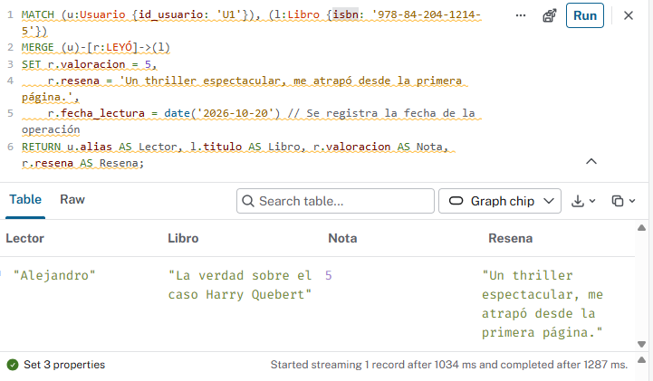
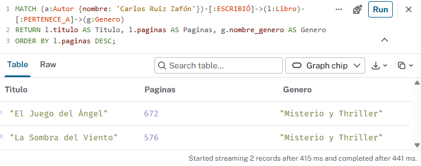
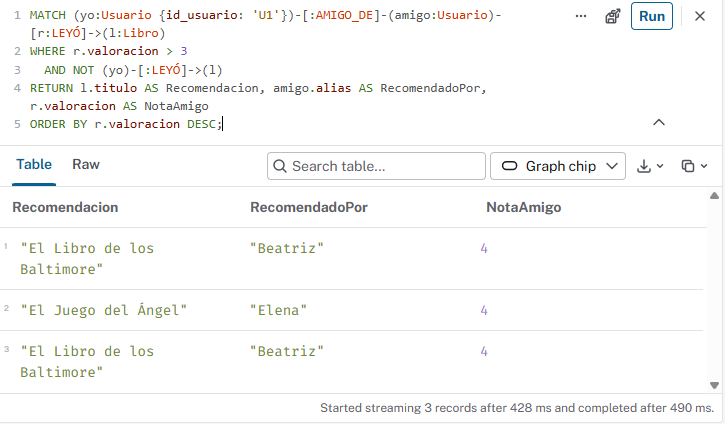
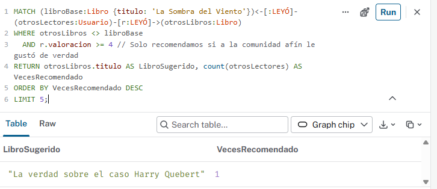
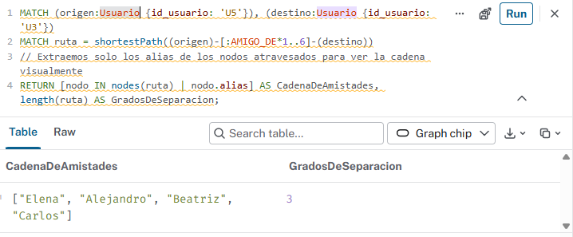

## Actividad 4: Resolver consultas Cypher y caminos complejos

A continuación, se presentan las consultas en lenguaje Cypher para resolver los distintos escenarios de negocio en nuestra plataforma de intercambio de libros, aplicando buenas prácticas y estructuración limpia.

### 1. Operación básica: Crear o actualizar con MERGE y SET
**Situación:** Un usuario actualiza su reseña, valoración y la fecha de lectura de un libro. Usamos `MERGE` para garantizar que la relación exista y `SET` para actualizar sus propiedades.

```cypher
// Buenas prácticas: Usamos MATCH para encontrar los nodos usando los índices previamente creados,
// y MERGE exclusivamente para garantizar la existencia de la relación antes de hacer SET.
MATCH (u:Usuario {id_usuario: 'U1'}), (l:Libro {isbn: '978-84-204-1214-5'})
MERGE (u)-[r:LEYÓ]->(l)
SET r.valoracion = 5,
    r.resena = 'Un thriller espectacular, me atrapó desde la primera página.',
    r.fecha_lectura = date('2026-10-20') // Se registra la fecha de la operación
RETURN u.alias AS Lector, l.titulo AS Libro, r.valoracion AS Nota, r.resena AS Resena;
```



### 2. Consulta de 1 salto: Buscar vecinos inmediatos
Situación: Queremos listar todos los libros escritos por el autor "Carlos Ruiz Zafón", incluyendo la información de su género (lo que implica un salto adicional muy ligero) y el número de páginas, ordenados por extensión.

```cypher
MATCH (a:Autor {nombre: 'Carlos Ruiz Zafón'})-[:ESCRIBIÓ]->(l:Libro)-[:PERTENECE_A]->(g:Genero)
RETURN l.titulo AS Titulo, l.paginas AS Paginas, g.nombre_genero AS Genero
ORDER BY l.paginas DESC;
```



### 3. Consulta de varios saltos (Multi-salto): Recomendación social
Situación: Buscar libros que han leído y valorado positivamente (> 3 estrellas) los amigos directos de un usuario (Alejandro, 'U1'), pero filtrando aquellos que Alejandro ya ha leído.

```cypher
// La relación AMIGO_DE se consulta sin flecha de dirección (-) para que sea bidireccional.
MATCH (yo:Usuario {id_usuario: 'U1'})-[:AMIGO_DE]-(amigo:Usuario)-[r:LEYÓ]->(l:Libro)
WHERE r.valoracion > 3 
  AND NOT (yo)-[:LEYÓ]->(l) // Patrón negativo: filtramos lo que "yo" ya tengo en mi biblioteca
RETURN l.titulo AS Recomendacion, amigo.alias AS RecomendadoPor, r.valoracion AS NotaAmigo
ORDER BY r.valoracion DESC;
```


### 4. Recomendación por afinidad: Filtrado colaborativo (Patrones comunes)
Situación: Descubrir afinidades de lectura. "A los usuarios que leyeron y les gustó La Sombra del Viento, también les gustó...". Esto busca usuarios afines a un nodo inicial, extrae sus otras lecturas y las cuenta.

```cypher
MATCH (libroBase:Libro {titulo: 'La Sombra del Viento'})<-[:LEYÓ]-(otrosLectores:Usuario)-[r:LEYÓ]->(otrosLibros:Libro)
WHERE otrosLibros <> libroBase 
  AND r.valoracion >= 4 // Solo recomendamos si a la comunidad afín le gustó de verdad
RETURN otrosLibros.titulo AS LibroSugerido, count(otrosLectores) AS VecesRecomendado
ORDER BY VecesRecomendado DESC
LIMIT 5;
```


### 5. Camino más corto: shortestPath
Situación: Calcular la ruta social más eficiente (grados de separación) entre dos usuarios de la plataforma que no se conocen directamente (ej. Elena 'U5' y Carlos 'U3') para poder pedirle prestado un libro físico a través de la cadena de confianza.

```cypher
// Calculamos el camino más corto permitiendo un máximo de 6 saltos (*1..6) por seguridad y rendimiento.
MATCH (origen:Usuario {id_usuario: 'U5'}), (destino:Usuario {id_usuario: 'U3'})
MATCH ruta = shortestPath((origen)-[:AMIGO_DE*1..6]-(destino))
// Extraemos solo los alias de los nodos atravesados para ver la cadena visualmente
RETURN [nodo IN nodes(ruta) | nodo.alias] AS CadenaDeAmistades, length(ruta) AS GradosDeSeparacion;
```



### 6. Análisis técnico: Index-Free Adjacency frente a JOINs Relacionales
A nivel de arquitectura e ingeniería de datos, la diferencia de rendimiento al ejecutar consultas de varios saltos (como la de la pregunta 3 o 5) entre Neo4j y un motor SQL tradicional (como PostgreSQL o MySQL) radica en cómo se gestionan las conexiones físicas en el disco y en la memoria RAM:

* Bases de datos Relacionales (SQL y JOINs):
En SQL, las relaciones se calculan "al vuelo". Para conectar Usuarios con Amigos y luego con Libros, el motor debe hacer varios JOIN cruzando claves foráneas (Foreign Keys). Para cada salto, la base de datos realiza una búsqueda en el índice B-Tree (coste logarítmico O(log N)) o, en el peor de los casos, escaneos completos de tablas. A medida que añades saltos (amigos de amigos de amigos), el conjunto intermedio de datos crece exponencialmente (producto cartesiano), consumiendo la memoria del servidor y ralentizando la consulta (de milisegundos a segundos o minutos). El rendimiento se degrada fuertemente según el volumen total de la base de datos.

* Neo4j (Adyacencia libre de índices / Index-Free Adjacency):
En un grafo nativo, la relación se persiste físicamente en el momento en que se crea (con el comando MERGE). Al insertar la relación [:AMIGO_DE], Neo4j guarda un puntero directo de memoria en el nodo de origen que apunta exactamente a la dirección física en disco del nodo destino.
Al ejecutar la consulta, el motor no necesita buscar en ningún índice global ni calcular intersecciones de tablas; simplemente hace una desreferencia de punteros en memoria (coste constante O(1) por salto). Recorrer 5 saltos es simplemente seguir 5 punteros en la RAM, resolviéndose en milisegundos. El rendimiento es proporcional a la porción del grafo que exploras, no al tamaño total de la base de datos.